# Performance Testing & Observability

A hands-on performance engineering project for the [GoShop backend](#repository-responsibilities), focused on measuring microservice throughput, latency, resource consumption and identifying bottlenecks before optimization.

The first case study covers `pricing-service`, a Kotlin / Java 21 / Spring Boot microservice backed by PostgreSQL and deployed as three replicas in a local Kubernetes cluster (kind). Load is generated by Grafana k6 and correlated with application, database and infrastructure metrics in a custom 34-panel Grafana dashboard.

## Highlights

- Built a Kubernetes-based load testing workflow with configurable arrival rates, virtual users, test identifiers and pass/fail thresholds.
- Integrated Spring Boot Actuator, Micrometer, Prometheus, PostgreSQL Exporter and Kubernetes monitoring into a single dashboard.
- Used k6 Prometheus Remote Write and pod-identification response headers to compare client/server latency and validate traffic distribution.
- Executed baseline and stress tests at target rates from 100 to 10,000 requests per second (RPS).
- Sustained a tested target of **1,000 RPS** for 60 seconds with **zero dropped iterations**, **0% HTTP errors** and **2.33 ms client p95**.
- Achieved a highest measured average throughput of **4,305.94 RPS** at a target of 5,000 RPS, with 0% HTTP errors but 13.84% dropped iterations. This is not a passing capacity result.
- Identified load-generator VU exhaustion, high shared CPU utilization, GC pressure and intermittent database connection-pool contention as priorities for controlled optimization.

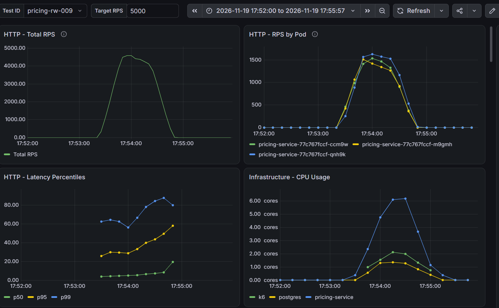

## Repository responsibilities

| Repository | Responsibility |
| --- | --- |
| `goshop` | Microservice source code, Docker images, Kubernetes manifests, application instrumentation and monitoring infrastructure. |
| `performance-testing` (this repository) | Reusable k6 scenarios, Kubernetes test Jobs, test results and performance engineering documentation. |

## Architecture

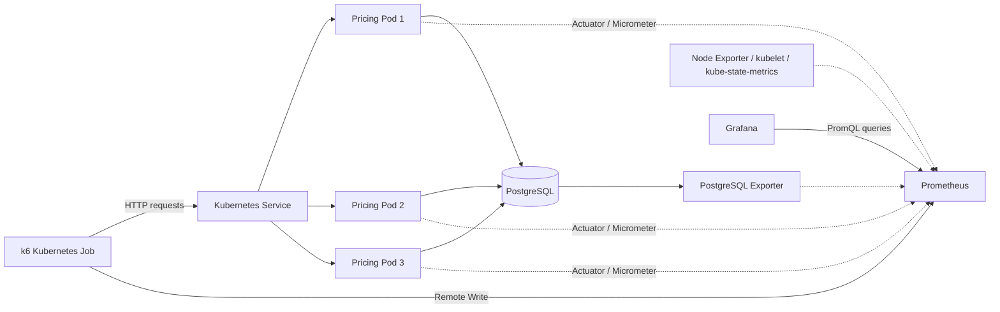

Dotted arrows represent metrics exposed to Prometheus for scraping. k6 pushes metrics using Remote Write. The application, database and load generator share the same Docker Desktop environment in this baseline; the three kind nodes do not represent three independent physical machines.

### Technology stack

| Layer | Technologies |
| --- | --- |
| Application | Kotlin, Java 21, Spring Boot, embedded Tomcat, HikariCP |
| Database | PostgreSQL 16, PostgreSQL Exporter |
| Infrastructure | Docker, kind, Kubernetes, Helm, kubectl |
| Observability | kube-prometheus-stack, Prometheus, Grafana, Micrometer, Spring Boot Actuator, Node Exporter, kube-state-metrics |
| Load testing | Grafana k6, constant-arrival-rate executor, Prometheus Remote Write |

## Testing methodology

| Parameter | Baseline configuration |
| --- | --- |
| Endpoint | `GET /api/exchange-rates` |
| Application replicas | 3 |
| Load generator | Kubernetes Job in namespace `goshop` |
| Executor | `constant-arrival-rate` (one HTTP request per iteration) |
| Measurement duration | 60 seconds |
| Preallocated / maximum VUs | 50 / 200 |
| HikariCP minimum / maximum pool size | 2 / 25 per replica |
| PostgreSQL `max_connections` | 100 |
| Application memory request / limit | 256 MiB / 1 GiB |
| Application CPU request | 200m per replica |

Pass criteria: client p95 below 100 ms, HTTP failure rate below 1%, no dropped iterations, all checks passing, and requests reaching each expected pod. A test can return HTTP 200 for every dispatched request and still fail because k6 could not start all planned iterations.

The dashboard uses **Test ID** and **Target RPS** variables. k6 series are separated by test ID; application and infrastructure series are correlated using the selected time range. The target line must match the configured rate of the Job.

## Grafana dashboard reference (34 panels)

The dashboard combines client-side load metrics and server-side telemetry to investigate where performance degrades. All screenshots below are actual measurements from the 5,000 RPS target run (`pricing-rw-009`, November 19, 2026), unless otherwise noted.

### 1. HTTP performance and infrastructure overview

| Panel | What it shows / why it matters |
| --- | --- |
| HTTP - Total RPS | Aggregate server-side request rate; detects throughput plateaus and degradation. |
| HTTP - RPS by Pod | Request rate per replica; helps detect uneven load distribution. |
| HTTP - Latency Percentiles | Server p50, p95 and p99; reveals typical and tail latency. |
| Infrastructure - CPU Usage | CPU cores used by pricing-service, PostgreSQL and k6; identifies resource competition. |

The overview screenshot at the top shows these four panels.

### 2. Kubernetes resources and connection pool

| Panel | What it shows / why it matters |
| --- | --- |
| Kubernetes - CPU Usage by Pod | CPU consumption per pod, with resource requests where configured; supports resource sizing. |
| Kubernetes - Memory Usage by Pod | Container memory usage against requests and limits; reveals memory pressure and sizing opportunities. |
| HikariCP - Connections | Active, idle and pool capacity metrics per replica; identifies pool saturation. |
| HikariCP - Pending Threads | Threads waiting for a database connection; exposes connection acquisition queues. |

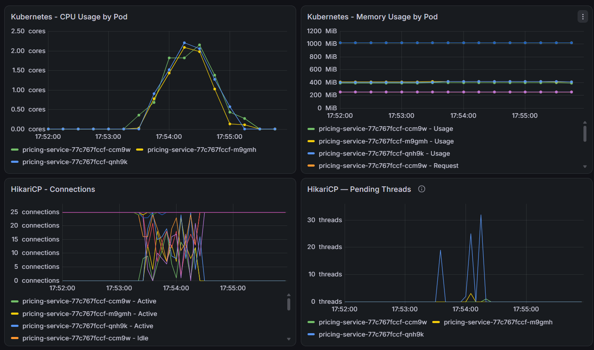

### 3. Connection acquisition and Tomcat threads

| Panel | What it shows / why it matters |
| --- | --- |
| HikariCP - Average Acquire Time | Average time to obtain a connection; identifies pool contention or connection creation delays. |
| HikariCP - Connection Timeouts | Connection acquisition timeouts; detects failed attempts to obtain a connection. |
| Tomcat - Threads | Busy, current and maximum worker threads; reveals thread-pool pressure. |
| Tomcat - Thread Pool Utilization | Busy threads relative to configured maximum; checks whether the worker pool approaches capacity. |

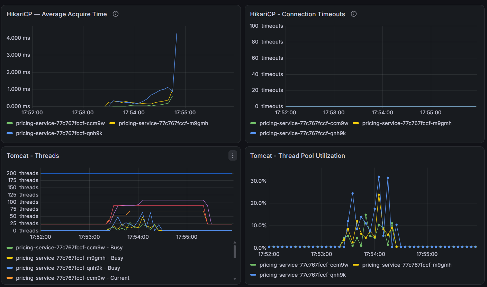

### 4. Tomcat connections and JVM memory

| Panel | What it shows / why it matters |
| --- | --- |
| Tomcat - TCP Connections | Current, keep-alive and maximum connections; checks connection capacity. |
| JVM - Heap Usage | Used, committed and maximum heap metrics; supports JVM memory tuning. |
| JVM - Metaspace Usage | Memory used for class metadata; helps identify abnormal growth. |
| JVM - Live Threads | Live and daemon threads; tracks thread growth under load. |

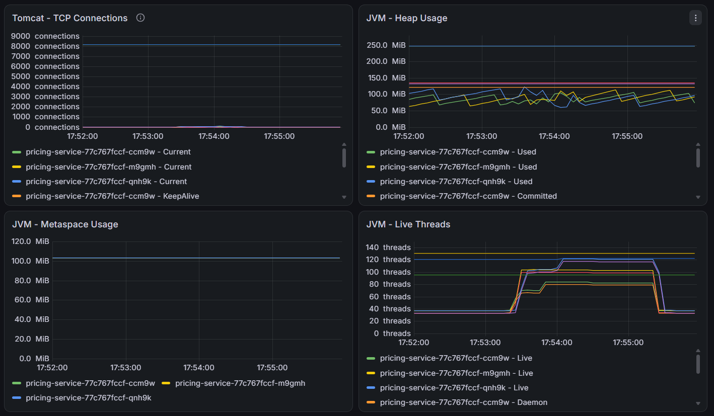

### 5. Garbage collection and database capacity

| Panel | What it shows / why it matters |
| --- | --- |
| JVM - GC Pause Time | Accumulated GC pause duration per second (ms/s), not individual pause latency; indicates pause overhead. |
| JVM - GC Frequency | GC events per minute, separated by action where available; reveals collection frequency. |
| JVM - Memory Allocation Rate | Rate of JVM object allocation (MiB/s); highlights allocation pressure. |
| PostgreSQL - Database Connections | Connections to the pricing database compared with the server-wide connection limit; supports connection budgeting. |

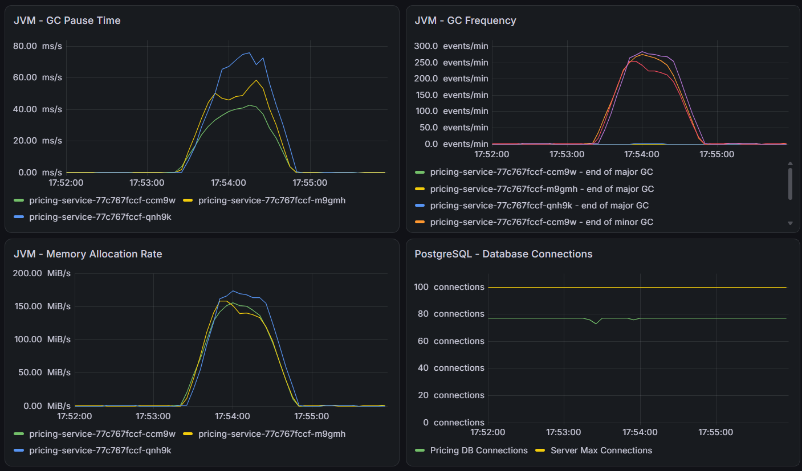

### 6. PostgreSQL activity

| Panel | What it shows / why it matters |
| --- | --- |
| PostgreSQL - Connections by State | Active, idle, idle-in-transaction and other connection states; highlights open transactions and connection usage. |
| PostgreSQL - Transactions per Second | Commit, rollback and combined transaction rates; correlates database activity with HTTP throughput. |
| PostgreSQL - Cache Hit Ratio | Shared-buffer hit ratio; helps assess buffer-cache effectiveness. |
| PostgreSQL - Locks | Lock counts grouped by lock mode; identifies locking activity, not necessarily blocked sessions. |

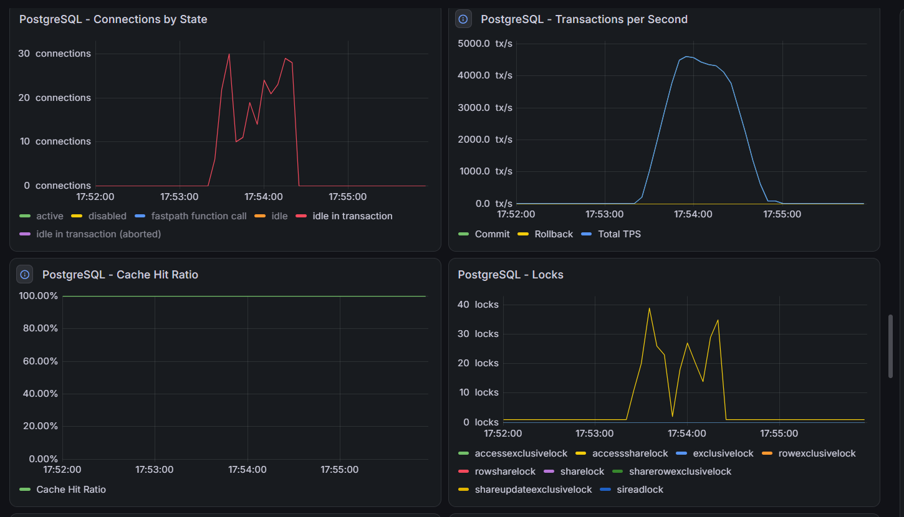

### 7. Database indicators and k6 throughput

| Panel | What it shows / why it matters |
| --- | --- |
| PostgreSQL - Deadlocks | Reported deadlocks; detects transaction conflicts that result in deadlocks. |
| PostgreSQL - Temporary Files | Temporary data volume; helps identify workloads that spill to temporary files. |
| k6 - Target vs Actual RPS | Configured target versus measured client request rate; quantifies delivery shortfalls. |
| k6 - Client Latency | Client-side average, p50, p95 and p99 HTTP request duration; measures latency observed by k6. |

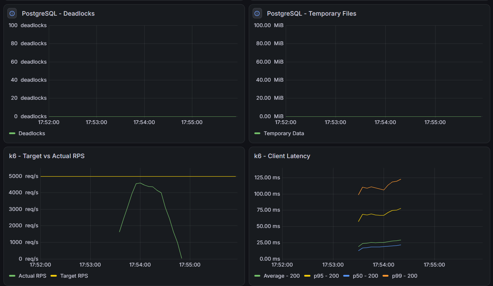

### 8. Client/server comparison and load generator health

| Panel | What it shows / why it matters |
| --- | --- |
| k6 - Client vs Server p95 | Compares client request duration with Spring server latency; helps localize delays without treating the difference as pure network latency. |
| k6 - Virtual Users | Current and allocated maximum VUs reported by k6; reveals generator capacity pressure. |
| k6 - Dropped Iterations | Iterations not started per second; detects inability to maintain the scheduled arrival rate. |
| k6 - HTTP Error Rate | Proportion of failed HTTP requests; tracks reliability independently of dropped iterations. |

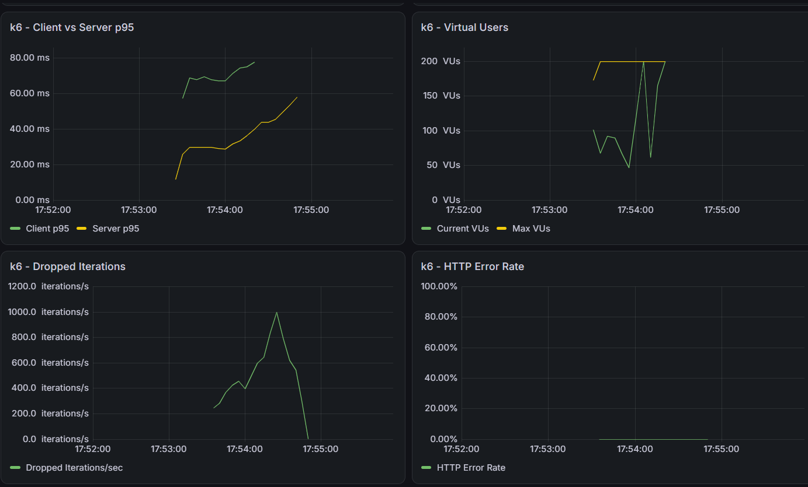

### 9. Load distribution and system CPU

| Panel | What it shows / why it matters |
| --- | --- |
| k6 - Requests by Pod | Client-observed requests per replica using the `X-Pod-Name` response header; independently verifies load distribution. |
| Infrastructure - Total CPU Usage | CPU utilization reported by Node Exporter; indicates shared infrastructure pressure in the local kind environment. |

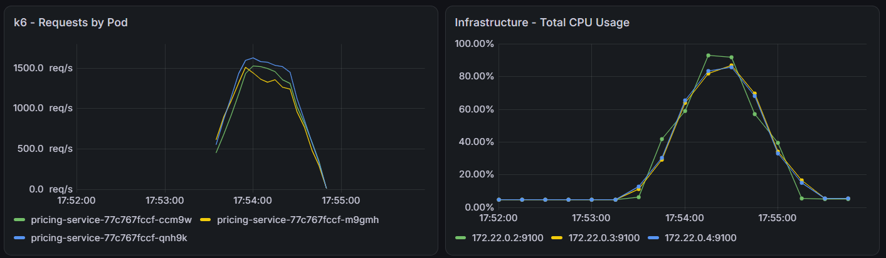

## Baseline results

All latency values in the table are client-side `http_req_duration` from the final k6 summaries, in milliseconds. Actual RPS is the reported `http_reqs` rate, not the maximum instantaneous rate in Grafana.

| Test | Target RPS | Actual RPS | Completed requests | Avg (ms) | p95 (ms) | p99 (ms) | Dropped | Result |
| --- | ---: | ---: | ---: | ---: | ---: | ---: | ---: | --- |
| RW-003 | 100 | 100.02 | 6,001 | 1.70 | 2.25 | 3.08 | 0 | PASS |
| RW-004 | 500 | 500.03 | 30,001 | 1.59 | 2.18 | 3.24 | 0 | PASS |
| RW-005 | 1,000 | 1,000.00 | 60,002 | 1.63 | 2.33 | 3.82 | 0 | PASS |
| RW-006 | 2,000 | ~1,980 | — | — | — | — | Observed | Incomplete report |
| RW-007 | 3,000 | 2,957.70 | 177,459 | 7.90 | 30.67 | 65.70 | 2,542 | FAIL |
| RW-007-repeat | 3,000 | 2,927.90 | 175,680 | 11.47 | 50.37 | 99.68 | 4,320 | FAIL |
| RW-008 | 4,000 | 3,880.18 | 232,812 | 15.05 | 51.66 | 92.42 | 7,189 | FAIL |
| RW-009 | 5,000 | 4,305.94 | 258,495 | 29.86 | 79.79 | 125.39 | 41,505 | FAIL |
| RW-010 | 10,000 | 3,958.95 | 237,819 | 41.21 | 98.06 | 152.07 | 362,183 | FAIL |

All runs with complete summaries reported 0% HTTP failures. RW-006 has only a partial text log; its approximate RPS and observed dropped iterations come from Grafana. The highest tested rate meeting the full criteria is 1,000 RPS; the exact boundary of sustainable capacity has not yet been established.

### Stress test: 10,000 RPS target

Doubling the target from 5,000 to 10,000 RPS reduced average throughput by approximately 8%. About 60% of scheduled iterations were dropped, while client p95 increased to 98.06 ms. The generator reached its 200-VU limit within approximately one second.

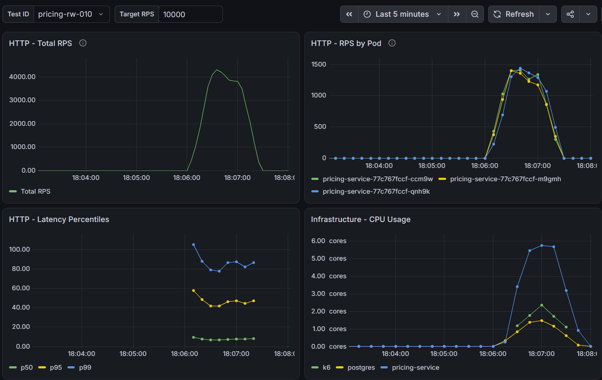

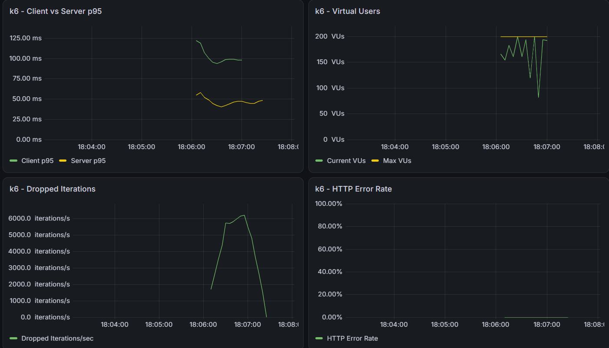

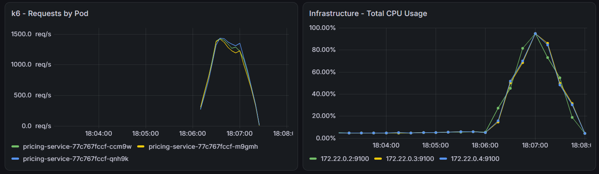

### Findings and engineering decisions

| Observation | Evidence | Next investigation |
| --- | --- | --- |
| Load-generator capacity | 200 VUs exhausted; 362,183 dropped iterations in RW-010 | Standardize warm-up, adjust VUs and isolate k6 on a separate host. |
| Shared CPU pressure | Node Exporter peaks of ~93% in RW-009 and ~95% in RW-010 | Measure CPU contention and throttling; separate generator and server resources. |
| JVM allocation and GC | ~76–77 ms/s peak pause rate per JVM; hundreds of MiB/s allocated across replicas | Profile with Java Flight Recorder and compare heap/GC configurations. |
| Database connection contention | Up to ~35 pending Hikari threads, no observed acquisition timeouts | Measure connection hold time and transaction duration before changing pool size. |
| PostgreSQL transaction behavior | Up to ~33 idle-in-transaction sessions; near-100% buffer hit ratio; no observed deadlocks | Investigate query duration, wait events and transaction boundaries. |
| Tomcat capacity | Peak thread utilization ~34% in RW-010 | Keep current maximum threads until evidence justifies a change. |
| Container memory | ~390–420 MiB per pod against 1 GiB limit | Test JVM sizing carefully; validate with longer-running tests. |

Infrastructure values are visual estimates from Grafana, not exact synchronized measurements. Correlation is used to form hypotheses, not to establish root causes. The local stress test measures the combined environment, not an isolated upper limit of the pricing-service or production capacity.

## Running the case study

Prerequisites: a running GoShop kind cluster, deployed pricing-service and PostgreSQL, monitoring stack with Remote Write receiver enabled, and `kubectl` configured for the cluster. Run commands from the root of `performance-testing`.

1. Ensure the context and application replicas are correct:

   ```powershell
   kubectl config current-context
   kubectl get pods -n goshop -l app=pricing-service
   ```

2. Publish the k6 script as a ConfigMap:

   ```powershell
   kubectl create configmap k6-pricing-script -n goshop --from-file=pricing-kubernetes.js=projects/goshop/pricing-kubernetes.js --dry-run=client -o yaml | kubectl apply -f -
   ```

3. Configure `projects/goshop/k6-job.yaml`: set `RATE`, `DURATION`, `PRE_ALLOCATED_VUS`, `MAX_VUS`, a unique `TEST_ID` and, when using per-pod thresholds, the current `POD_NAMES`. Keep the target value in Grafana consistent with `RATE`.

4. Replace the previous Job and run the scenario (save old logs first):

   ```powershell
   kubectl delete job k6-pricing -n goshop --ignore-not-found
   kubectl apply -f projects/goshop/k6-job.yaml
   kubectl logs -f job/k6-pricing -n goshop
   ```

5. After completion or failure, save the final k6 summary:

   ```powershell
   New-Item -ItemType Directory -Force results/goshop | Out-Null
   kubectl logs job/k6-pricing -n goshop > results/goshop/pricing-test.txt
   ```

6. Open Grafana and select the test ID and its absolute time range:

   ```powershell
   kubectl port-forward -n monitoring service/monitoring-grafana 3000:80
   ```

   Grafana: <http://localhost:3000>

The baseline uses the experimental Prometheus Remote Write output. The k6 logs warn that this output is deprecated; migration to OpenTelemetry is a future compatibility task.

## Roadmap

- [x] Deploy pricing-service and PostgreSQL to local Kubernetes.
- [x] Configure application, database and infrastructure observability.
- [x] Integrate k6 Remote Write and build a 34-panel Grafana dashboard.
- [x] Complete baseline and stress testing from 100 to 10,000 target RPS.
- [ ] Standardize warm-up, initial connection-pool state and repeated test runs.
- [ ] Isolate the load generator and establish sustainable throughput under defined thresholds.
- [ ] Profile JVM allocations, GC, transactions, SQL and HikariCP; measure improvements independently.
- [ ] Evaluate horizontal scaling, HPA, Redis caching and zero-downtime deployments.
- [ ] Move experiments to AWS EKS with Terraform and evaluate cost per million requests.

## Scope and limitations

This is a local performance engineering case study, not a production benchmark. The workload repeatedly reads a small exchange-rate dataset, so the results do not represent larger catalogs, mixed read/write workloads or independent Kubernetes machines. Test duration is only one minute; long-duration stability and repeatability remain to be validated. The screenshots document an existing dashboard; this README bundle does not include a Grafana dashboard JSON export or the original Kubernetes manifests.
